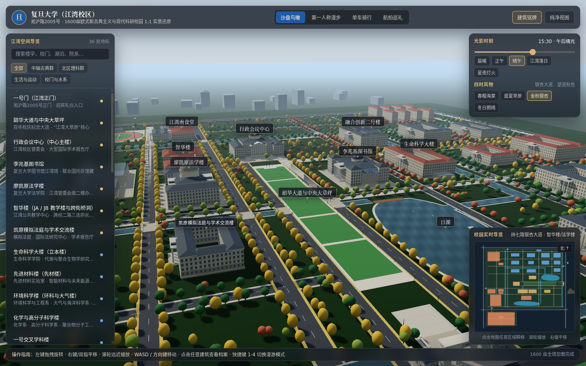

# 复旦大学（江湾校区）Three.js 三维数字孪生系统



基于 **Three.js + Vite + 自定义 GLSL 着色器 + 程序化新古典主义建筑生成引擎** 构建的复旦大学江湾校区（上海市杨浦区淞沪路 2005 号，总面积约 1,600 亩）`1:1` 米制比例三维漫游系统。

## 还原亮点

- **中轴欧式新古典主义礼仪群**：一号门凯旋柱廊（“復旦大學”匾额）、380 米韶华大道与“江湾大草原”中央大草坪、行政会议中心古典山花门廊与穹顶、李兆基图书馆伴水柱廊与八角穹顶、廖凯原法学楼国会式肋架大穹顶与门前守护神兽“獬豸”、智华楼（JA / JB / JC）及横跨经二路的三连拱跨街桥洞长廊。
- **北区基础理科与交叉创新矩阵**：生命科学大楼（含院名刻字巨石与生态温室）、化学与高分子科学楼（近 6 万㎡ 多翼院落）、二号交叉学科楼（计算机与智能创新学院 / 玻璃采光中庭）、一号交叉学科楼、物理科研楼、上海数学中心、环境科学楼（屋顶气象雷达圆顶）、先进材料楼、融合创新一/二号楼、发育生物学研究所。
- **江南水乡生态水脉与生活运动区**：自定义 GLSL 波光着色器还原日湖、月湖、卿云河、纬五河、日月连通河、护校河及 14 座欧式汉白玉石拱桥；综合体育馆与恒温游泳馆、400 米标准八跑道田径场、五号门篮排网球场群；南北双食堂、北苑学生生活园区及国权北路 1380 号江湾生活园区（1–17 号楼与光华 Mall）。
- **四时风物与昼夜星辰**：支持 `05:30–22:30` 晨曦、正午、江湾落日、星夜自习灯火无级切换，以及春樱海棠、盛夏草原、金秋银杏（望道路落叶地毯）、冬日朗晴四季变换。
- **四模式无缝漫游**：沙盘鸟瞰（`1`）、`1.72m` 第一人称漫步（`2`）、纬七路/智华楼桥洞单车骑行（`3`）、十大机位无人机航拍巡礼（`4`），配五经七纬实时导览雷达小地图（支持点击任意区域瞬移）。

## 目录结构

```text
├── index.html                 # 应用入口与响应式交互 HUD 界面
├── vite.config.js             # Vite 生产打包配置（相对路径 + Three.js 分包）
├── .github/workflows/         # GitHub Pages 自动打包与部署工作流
└── src/
    ├── main.js                # WebGL 渲染器、加载管线与主循环
    ├── styles/main.css        # 复旦学术蓝与古典石材金 UI 样式系统
    ├── data/campusData.js     # 1600 亩五经七纬路网、水系、石桥与 36 处地标空间数据
    ├── world/
    │   ├── textures.js        # 程序化高精度石材立面、自习窗格灯光、运动场与牌匾贴图
    │   ├── architecture.js    # 新古典主义与现代科研建筑三维生成器
    │   ├── landscape.js       # GLSL 水体着色器、四季植被、校车单车与湿地白鹭
    │   └── atmosphere.js      # 大气散射天空穹顶、太阳轨迹与 1400 颗星辰粒子系统
    ├── controls/navigation.js # 鸟瞰 / 漫步 / 骑行 / 航拍四模式相机控制器
    └── ui/hud.js              # 3D 悬浮建筑铭牌、分类检索、档案抽屉与实时小地图
```

## 本地开发与生产打包

```bash
# 安装依赖
npm install

# 启动本地开发服务器
npm run dev

# 构建生产静态包（输出至 dist/）
npm run build

# 预览生产构建产物
npm run preview
```

## GitHub Pages 在线部署

仓库已内置 [`.github/workflows/deploy.yml`](./.github/workflows/deploy.yml) 自动构建工作流。在仓库 **Settings → Pages → Build and deployment** 中将 **Source** 设为 **GitHub Actions**，每次推送至 `main` 分支即可自动打包发布在线预览站点。
