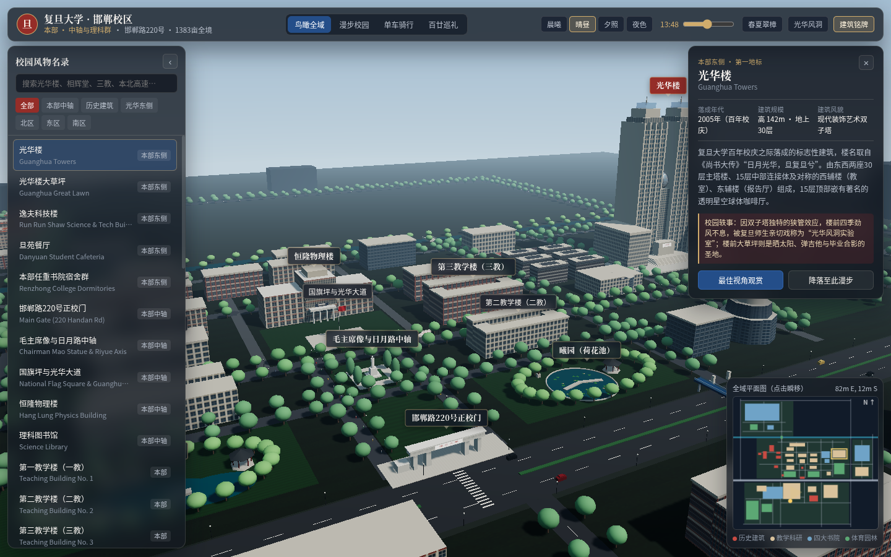

# 复旦大学（邯郸校区）三维全景数字孪生 · Fudan University (Handan Campus) 3D



基于 **Three.js + Vite** 1:1 米级比例还原的**复旦大学邯郸校区**（占地约 1,383 亩）交互式三维校园数字孪生。完整涵盖**本部（中轴与百年历史建筑群 + 东侧光华楼群）**、**北区（研究生与留学生生活园区）**、**东区（志德书院与新闻学院）**与**南区（希德书院、经管文科与正大体育馆）**四大片区，以及邯郸路中环地道、国权路、国顺路、国定路、走马塘水系与地铁18号线复旦大学站等周边城市肌理。

## 核心特性

- **四大片区真实空间拓扑还原**
  - **本部中轴与理科群**：邯郸路220号正校门（毛体校名匾额）、毛主席像（12.26m 比例还原）、光华大道与复旦校训墙、国旗坪（顶点风动五星红旗）、恒隆物理楼、理科图书馆（含陈望道铜像）、一教/二教/三教（含“三教校猫”彩蛋）、立人生物楼、化学楼、逸夫楼与科学楼。
  - **本部西区百年历史建筑群**：登辉环路与椭圆形大草坪、相辉堂（1947白墙黑瓦二层破屋面、桥形外楼梯、周谷城题匾及2023扩建北堂）、子彬院“小白宫”（1925爱奥尼半圆门廊）、校史馆奕柱堂（1921亨利·墨菲古典重檐飞角）、寒冰馆、景莱堂博物馆群、1921江湾仿古木制老校门、上海地铁18号线复旦大学站红砖拱门。
  - **本部东侧光华核心**：光华楼（142m 30层双子主塔、15层透明星空球体咖啡厅、东西辅楼、花岗岩大台阶与广场）、光华大草坪、旦苑餐厅、任重书院宿舍群、八角造型逸夫科技楼。
  - **园林与水系**：西侧燕园（江南曲池、太湖石假山、粉墙月洞门、世纪钟亭与南轩）、东侧曦园（圆形荷花池、九曲石桥、六角亭与谢希德老校长铜像）、走马塘支流河道与连接本北的“本北高速”跨河桥。
  - **北区园区**：北苑餐厅、北区体育馆（银色圆拱屋顶）与球场矩阵、30余栋暖橙坡屋顶研究生公寓及留学生双子塔公寓。
  - **东区园区**：跨国定路的志德书院围合式本科生公寓群、新闻学院与蔡冠深报告厅、复宣酒店塔楼。
  - **南区园区**：正大体育馆（白色椭圆张拉膜穹顶与7道银色外露拱肋）、400米标准田径场与游泳馆、希德书院宿舍群、复旦皇冠假日酒店、经济学院、文科大楼、五教/六教、文科图书馆、玖园（陈望道旧居《共产党宣言》展示馆、苏步青旧居、谈家桢旧居）及管理学院院区（李达三楼、史带楼、思源楼）。
  - **城市动脉与立体交通**：邯郸路双向主干道、中环线邯郸路地道东西下穿出入口（车流真实下穿潜入地道）、国权路与国顺路两座跨街人行天桥。
- **四种沉浸导览模式**
  - **俯瞰全景（Orbit）**：自由旋转、平移、缩放并支持点击三维建筑拾取档案。
  - **步行漫游（Walk）**：1.7m 人眼视角，`WASD` 移动、`Shift` 疾跑，穿越梧桐光华大道与相辉草坪。
  - **单车骑行（Bike）**：复旦特色骑行视角，支持冲刺跨越“本北高速”与四大园区。
  - **十景导览（Guided Tour）**：精选复旦十大地标自动运镜巡礼与建筑历史解说。
- **动态光影、四季与校园生态**
  - **24小时实时太阳轨迹与夜景辉光**：支持晨曦、正午、黄昏、星夜一键切换与无级滑块调节；夜晚自动点亮千余扇建筑暖色窗格、路灯与光华楼顶红色航标灯，配合 `UnrealBloomPass` 呈现真实夜景。
  - **春夏梧桐 / 金秋银杏一键切换**：约 2,400 株实例化法国梧桐、银杏与香樟随季节变换色彩。
  - **“光华风洞”流场可视化**：一键开启光华楼双子塔狭管效应三维流线动画。

## 本地运行

```bash
cd fudan-handan-3d
npm install
npm run dev
```

生产构建：

```bash
npm run build
```
