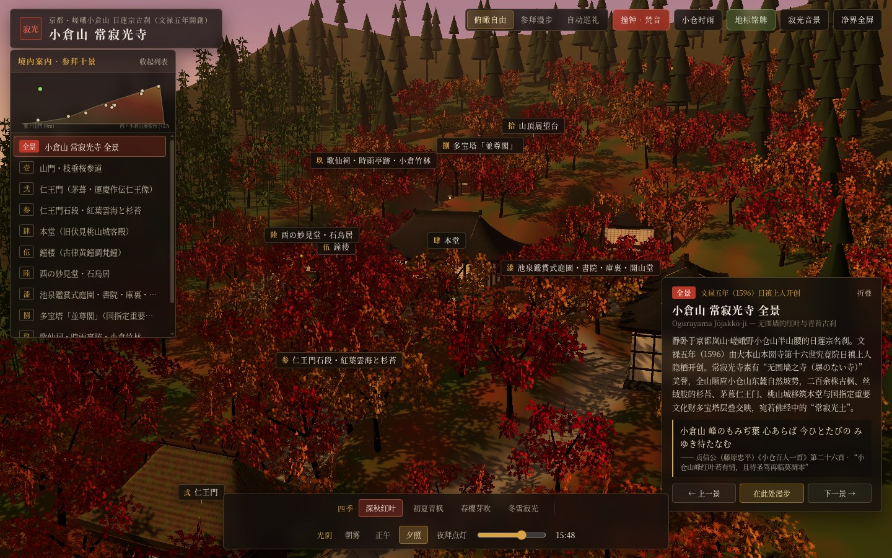

# 小倉山 常寂光寺 (Ogurayama Jōjakkō-ji) — Three.js 全境三维数字还原

基于 **Three.js + Vite** 对京都岚山·嵯峨野名刹 **小倉山 常寂光寺（Jōjakkō-ji Temple）** 进行的全方位三维地形、古建筑群与四季光影还原。



## 还原范围（境内十景与全山地理格局）

遵循常寂光寺真实“**东低西高、依小仓山东麓拾级而上、无围墙古刹（塀のない寺）**”的山地格局，完整构建：

1. **山门与枝垂樱参道**：江户后期墨色角材格子药医门、寺号石标“小倉山常寂光寺”、黑穗竹垣、拜观受付、展示场、枝垂樱与藤原定家山庄迹石碑。
2. **仁王门（境内最古·贞和年间 1345–1349）**：覆生青苔的厚重茅葺（藁葺）入母屋屋顶、运庆作传阿吽仁王像，以及信众祈愿足腰安康奉纳的大草鞋（大わらじ）。
3. **仁王门四十四级石段参道**：两畔杉苔（地毯苔）与竹结界扶手、二百余株七裂伊吕波枫（いろは紅葉）交织的红叶云海与“敷红叶”落叶地毯。
4. **本堂（旧伏见桃山城客殿移筑）**：庆长年间小早川秀秋助力移筑、平瓦葺入母屋造、向拜钓灯笼、赛钱箱与伏见常照院宫御笔“御祈祷处”扁额。
5. **钟楼（宽永十八年 1642）**：悬吊青木一郎博士声学设计的“古律黄钟调”青铜梵钟，支持交互撞钟与 Web Audio 差拍泛音（うなり）合成。
6. **酉之妙见堂与石鸟居**：神佛习合石鸟居、江户商家（大黑屋、松屋等）奉纳石灯笼、玉垣与九曜纹幕布拜殿。
7. **池泉鉴赏式庭园·书院·库里·开山堂**：涌水镜池、锦鲤游弋、雪见灯笼、蹲踞竹笕、五重石塔、渡廊、白壁木组库里与开山堂。
8. **多宝塔“并尊阁”（国指定重要文化财·元和六年 1620）**：方三间下层、白漆喰“龟腹”、圆形上层高栏、桧皮葺屋顶、灵元上皇宸笔“并尊阁”敕额与九轮水烟青铜相轮。
9. **歌仙祠（謌僊祠）·时雨亭迹·小仓竹林**：富冈铁斋扁额歌仙祠、藤原定家《小仓百人一首》时雨亭础石遗迹、绯毛毡床几与朱伞、南坡孟宗竹林及小仓山鹿。
10. **山顶展望台**：俯瞰多宝塔相轮与漫山红叶树冠，远眺嵯峨野平原、桂川渡月桥、京都市街及东山三十六峰与比睿山天际线。

## 交互功能

- **三种游览视角**：`俯瞰自由`（OrbitControls 阻尼环绕 + 点击建筑对焦）、`参拜漫步`（第一人称沿真实地形与石阶行走 `WASD` + 鼠标拖拽环视）、`自动巡礼`（十景电影运镜导览 + 《小仓百人一首》和歌赏析）。
- **四季流转**：`深秋红叶`、`初夏青枫`、`春樱芽吹`、`冬雪寂光`。
- **光阴与天气**：支持 `05:30 – 21:00` 连续太阳轨迹（含朝雾逆光、夕照染枫、夜间特别拜观星空北斗七星与石灯笼点灯）及 **小仓时雨** 细雨山雾开关。
- **寂光音景**：纯 Web Audio API 实时程序化合成山风、竹叶、鹿威（ししおどし）、黄莺啼鸣与古律黄钟调梵钟余韵。

## 目录内预置 `.zip` 离线包说明

本目录下已直接内置两份打包好的 `.zip` 压缩归档，可直接下载使用：

- **[`jojakko-ji-3d-dist.zip`](./jojakko-ji-3d-dist.zip)**：纯静态生产构建包（内含 `index.html` 与分包压缩后的 `assets/`，已配置相对路径 `./`，解压后通过任意静态服务器托管即可直接运行）。
- **[`jojakko-ji-3d.zip`](./jojakko-ji-3d.zip)**：完整独立工程压缩包（包含全部源码 `src/`、`package.json`、`vite.config.js`、`README.md` 以及预编译好的 `dist/`，不含 `node_modules/`）。

## 本地开发与生产打包

```bash
cd jojakko-ji-3d

# 安装依赖并启动开发服务器
npm install
npm run dev

# 生产环境打包（输出至 dist/）
npm run build
```
