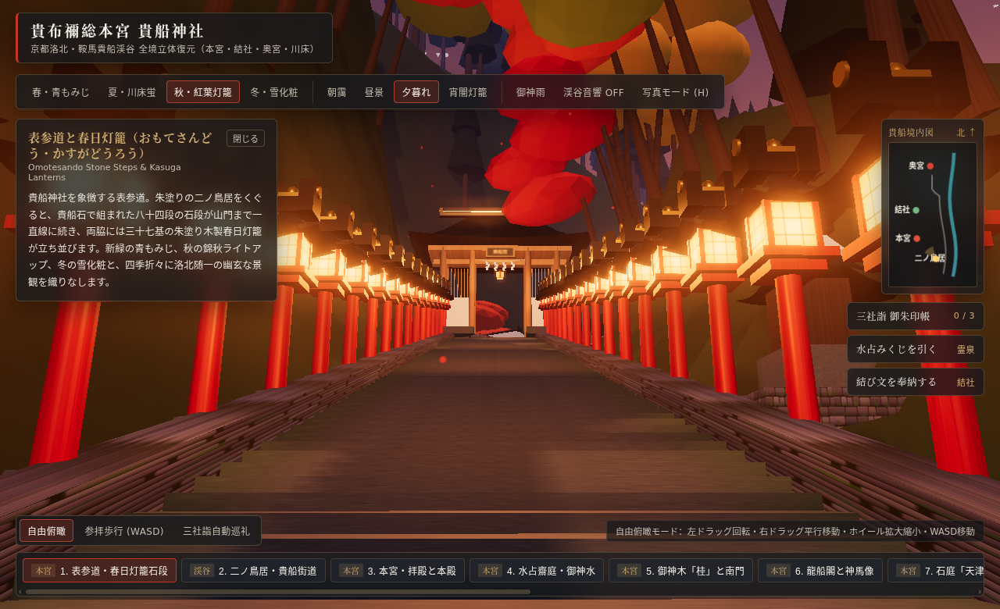

# 貴布禰総本宮 貴船神社 — Three.js 全境立体復元



> **打包压缩包**：本目录下已内置两份压缩包：
> - [`kifune-shrine-3d.zip`](./kifune-shrine-3d.zip)：完整项目源码 + 生产构建产物（`dist/`）一体化压缩包
> - [`kifune-shrine-3d-dist.zip`](./kifune-shrine-3d-dist.zip)：纯静态生产构建包（`dist/`），可直接托管部署

使用 **Three.js + 自定义 GLSL 着色器 + 程序化 PBR 材质 + Web Audio 空间声景** 完整还原京都洛北水神总本宫 **贵船神社（貴布禰総本宮 貴船神社）** 的三社全境与贵船川溪谷生态。

## 还原范围（全五区・三社诣完整动线）

1. **南参道与贵船川床料理街（渓谷・門前）**
   - **梅宮橋・梅宮社・白石社・蛍岩**
   - 沿贵船川多级叠水小滝架设的三座传统 **川床（かわどこ）** 纳凉席（叠席、绯毛毡、座卓、竹帘、雪洞灯笼）与京町家风料理旅馆（右源太・ひろ文・左源太意象）
2. **表参道石段与本宫境内（本宮）**
   - **二ノ鳥居** 与社号标石柱
   - **八十四级表参道石段** 与两侧精确排列的 **三十七基朱涂木制春日灯笼（春日灯籠）** 及红叶拱廊
   - **南門（四脚門）**、树龄四百年呈升龙之姿的 **御神木「桂」**、**祖霊社**、**手水舎**
   - 自高台石垣悬挑而出的 **龍船閣（懸造展望休憩所）** 与绘马发祥之地 **黒馬・白馬神馬像** 及绘马挂
   - 平成御造营木曾桧 **本宮拝殿（入母屋造銅板葺き）**、内阵高台 **本宮本殿（三間社流造）** 与 **権殿**
   - 石垣涌泉 **御神水** 与漂浮水占签的 **水占齋庭**
   - **社務所・授与所**、**斎館**、重森三玲作庭的全贵船石船形石庭 **「天津磐境」**
   - **北参道（裏参道）**、**鈴鹿谷の滝**、**牛一社・川尾社**
3. **结社・中宫（結社 — 恋の宮）**
   - 丸太山道石阶、**結社鳥居**、祀奉磐长姬命的 **結社本殿**
   - 重达六吨的自然船形贵船铭石 **「天乃磐船」**
   - 挂满薄绿色结文签的 **結び文掛け**
   - **和泉式部歌碑**、**松尾巌句碑** 与 **結社御神木「桂」**
4. **千年杉参道与思ひ川（参道）**
   - 同根双干树龄千年的 **相生の杉** 与 **二ツ社（林田社・私市社）**
   - 和泉式部禊川 **思ひ川（御物忌川）**、**思ひ川橋**、**奥宮鳥居**、千年杉并木与紫辉巨石 **つつみヶ岩**
5. **奥宫创建圣域与龙穴（奥宮）**
   - **奥宮手水舎** 与深林朱涂 **奥宮神門**
   - 杉枫合体的御神木 **連理の杉**、**日吉社**、**吸葛社**
   - 覆藏玉依姬命「黄船」的长十米苔石舟冢 **船形石（御船型石）**
   - 古色桧造 **奥宮拝殿**、镇座于日本三大龙穴 **「龍穴」** 正上方的 **奥宮本殿**、**鈴市社** 与注连绳围绕的 **権地**

## 交互体验与环境系统

- **四季 × 四时段 × 御神雨实时切换**：春（青もみじ）、夏（川床与源氏萤火虫）、秋（锦秋红叶灯笼ライトアップ与落叶）、冬（全境屋顶/灯笼笠/杉林积雪与降雪）；朝霭、昼景、夕暮、宵闇星空灯笼；以及水神高龗神祈雨 **「御神雨」** 湿润石阶反光效果。
- **十二景摄影机预设 + 自由俯瞰 + 参拜步行（WASD 沿石段与桥梁真实攀登）+ 三社诣自动巡礼运镜**。
- **三大神社文化交互**：
  - **三社詣 御朱印帳**：在本宫、奥宫、结社前完成「二礼二拍手一礼」参拜（伴随赛钱、本坪铃摇动与二拍手回响），实时钤印朱印与墨书。
  - **水占みくじ**：将白纸神签浮于水占斋庭灵泉之上，随水波涟漪渐次浮现吉凶与和歌。
  - **薄緑の結び文**：在结社书写心愿并实际系挂一枚 3D 薄绿结文签至结所。

## 本地运行与打包构建

```bash
# 安装依赖
npm install

# 启动本地开发服务器
npm run dev

# 生产环境打包构建（输出至 dist/，支持任意静态托管与 GitHub Pages）
npm run build

# 预览打包产物
npm run preview
```
