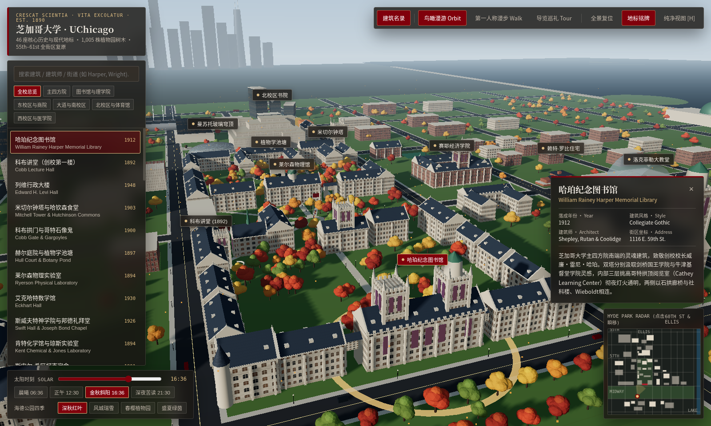

# The University of Chicago 3D Campus · 芝加哥大学全景三维建筑复原



基于 **Three.js + Vite** 构建的芝加哥大学海德公园（Hyde Park）全校区 `1:1` 街区轴网三维交互建筑群复原项目。

## 复原范围与核心亮点

1. **真实芝加哥海德公园地理街区坐标轴网（1 Unit = 1 Meter）**
   - **南北向大道**：S Cottage Grove Ave → S Maryland Ave → S Drexel Ave → S Ingleside Ave → **S Ellis Ave（校园中轴）** → S Greenwood Ave → **S University Ave** → **S Woodlawn Ave** → S Kimbark Ave → S Kenwood Ave → S Dorchester Ave → S Stony Island Ave → **密歇根湖畔（Promontory Point）与杰克逊公园科学与工业博物馆铜顶远景**。
   - **东西向街道**：E 55th St → E 56th St → **E 57th St** → E 58th St（主四方院林荫步行轴）→ **E 59th St / 奥姆斯特德 Midway Plaisance 下沉式世博公园大道** → **E 60th St** → E 61st St，远端北向天际线耸立芝加哥市中心 Loop 摩天大楼群（Willis Tower、John Hancock、Aon Center）。

2. **主四方院（Main Quadrangles）七大历史庭院与印第安纳石灰岩哥特群落**
   - **William Rainey Harper Memorial Library**：双塔（西侧剑桥国王学院雉堞塔与东侧牛津基督堂八角冠塔）、Cathey 拱顶阅览室花窗与东西两侧石拱天桥。
   - **Tower Group & Cobb Gate**：复刻牛津莫德林钟塔的 **Mitchell Tower**、**Hutchinson Commons**、**Reynolds Club**、**Mandel Hall** 以及雕有攀爬石像鬼的 **Cobb Gate**。
   - **Hull Biological Courts & Botany Pond**：锻铁石雕 **Hull Gate**、石拱小桥、睡莲池塘与四合生物馆群。
   - **Cobb Lecture Hall（1892创校第一楼）与 C Bench**、**Edward H. Levi Hall**、**Ryerson 物理实验室（八角天文观测圆顶）**、**Eckhart 数学馆**、**Kent 八角大讲堂与 Jones 实验室（钚元素分离国家历史地标）**、**Snell–Hitchcock 宿舍**、**Swift 神学院与铜绿尖塔 Bond Chapel**、**Rosenwald / Walker / Stuart**、**Classics 四合院**与 **Social Science 四合院**。

3. **跨越百年的美国现代建筑大师博物馆**
   - **Bertram Goodhue**：207英尺高 **Rockefeller Memorial Chapel（洛克菲勒纪念大教堂）**。
   - **Frank Lloyd Wright**：世界文化遗产草原学派代表作 **Frederick C. Robie House（罗比住宅）**。
   - **SOM (Walter Netsch)**：粗野主义深槽石灰岩巨构 **Joseph Regenstein Library**。
   - **Helmut Jahn**：无柱钢网壳椭球玻璃穹顶 **Joe and Rika Mansueto Library**。
   - **Henry Moore**：第一座可控核反应堆 CP-1 旧址青铜纪念碑 **《Nuclear Energy》**。
   - **César Pelli**：五根倾斜钢桅杆与悬索波浪屋顶 **Gerald Ratner Athletics Center**。
   - **Eero Saarinen**：折纸棱镜玻璃幕墙与镜面喷泉水池 **Laird Bell Law Quadrangle（法学院）**。
   - **Ludwig Mies van der Rohe**：黑色工字钢与玻璃神殿 **Crown Family School (SSA)**。
   - **Rafael Viñoly**：**Booth 商学院 Harper Center** 哥特弧形钢构阳光中庭与西校区十层空中医院 **Center for Care and Discovery (CCD)**。
   - **Studio Gang**：**Campus North Residential Commons** 斜向预制混凝土翼片塔楼。
   - **Diller Scofidio + Renfro**：**David Rubenstein Forum** 十层错动悬挑大厦。
   - **Tod Williams Billie Tsien**：**Reva and David Logan Center for the Arts**。
   - **Ricardo Legorreta**：**Max Palevsky Residential Commons** 暖色几何院落。

4. **四季植物园、昼夜光影与三种漫游模式**
   - **实时太阳轨迹（00:00–24:00）**：支持晨曦、正午、金秋斜阳与深夜苦读模式（入夜后全校哥特花窗、Mansueto 水晶穹顶与路灯自动亮起暖光）。
   - **海德公园四季切换**：深秋红叶（飘落秋叶粒子）、风城瑞雪（积雪屋顶与飘雪）、春樱植物园、盛夏绿茵。
   - **三种交互视角**：鸟瞰漫游（Orbit + WASD 平移）、第一人称校园漫步（1.85m 人眼高度自由穿行拱门与下沉大道）、12 站全自动电影感导览巡礼（Guided Tour），配合右上/右下实时海德公园雷达小地图点击瞬移。

## 压缩包下载（已随子目录内置）

本目录内已直接附带打包好的 `.zip` 归档文件，方便直接下载离线使用或部署：

- **[`uchicago-3d-campus.zip`](./uchicago-3d-campus.zip)**：完整工程与预编译包（包含完整源码 `src/`、配置文件 `package.json` / `vite.config.js`、实景预览图 `docs/preview.png` 以及预构建好的静态产物 `dist/`）。
- **[`uchicago-3d-campus-dist.zip`](./uchicago-3d-campus-dist.zip)**：轻量纯静态生产部署包（仅含编译压缩后的 `dist/` 静态资源，解压至任意 Web 服务器或静态托管目录即可运行）。

## 本地开发与打包部署

```bash
cd uchicago-3d-campus

# 安装依赖
npm install

# 启动本地开发服务器
npm run dev

# 生产环境打包（输出至 ./dist，采用相对路径适配任意子目录与 GitHub Pages）
npm run build
npm run preview
```

### GitHub Pages 自动部署

仓库根目录 [`.github/workflows/deploy.yml`](../.github/workflows/deploy.yml) 已集成 `uchicago-3d-campus` 的自动构建与制品归档：每次推送至 `main` 分支会自动生成 `uchicago-3d-campus-dist` 构建产物，并在开启 GitHub Pages（Source 选择 **GitHub Actions**）后同步发布至 `https://jingzhou-code.github.io/code-with-ai-for-fun/uchicago-3d-campus/`。
